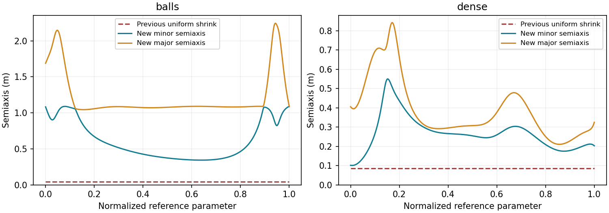

# 修正“全程缩成细管”的生成方式

2026-10-27。上一版把碰撞验证通过当成了质量验收，实际默认返回的往往是统一缩小后的解析圆管。该方案已从 ROS 生成流程移除。本报告取代上一轮工程报告中关于默认后端、验收流程及端到端速度的结论。

## 问题不是 LP 求得不够快

旧流程先按原始点云求 LP，再用最大半轴/中心偏移构造球，球扩张参考 Bézier 包围盒。只要一个区间未通过，就让整个全局管道乘 0.7，最多重复 20 次。薄而宽的椭圆被球界错误地扩张到其他方向；真实的局部瓶颈和保守的包围误拒绝均导致全程缩小。原先“最佳”结果经常是半径 4–9 cm 的常数初值管道，而不是原 LP 的有效形状。

此外，纯长度 A* 和仅看可见性的路径简化会贴近障碍物，留下很小的中心自由空间。求解器替换不能修正这两个几何问题。

## 本次实现

- 删除 worker 中的统一缩放循环。没有认证结果时失败，不再发布极细缩小管充当成功结果。`shrink_factor` 保留兼容字段，当前成功结果恒为 1。
- A* 加入净空偏好 `clearance_weight=4`；六邻域距离场只用于代价，不用于碰撞证明。路径简化必须同时通过连续碰撞检查和积分代价检查，避免再次抹掉路径的净空收益。设为 0 可回到长度代价作对比，不保证走廊质量。
- 新增 `corridor_check.cpp`：保留椭圆方向、偏移和长短轴的区间支撑界，逐个与膨胀占据体素及地图六个边界分离。球界只辅助推导参数扰动，不再直接作为世界管道的验收形状。
- 截面平面与占据体素相交得到凸多边形，求当前凸二次函数 q 在多边形上的最小值；碰撞点作为新的线性 q 约束加入 LP。沿 q 梯度向内偏移最多 1 cm 作为切点裕量，避免数值相切循环。
- 自适应截面采样先用于发现切点，再做全区间递归验证。采样 oracle **永远不能返回连续验证通过**。空切片邻近处用交替投影提出候选分离方向，但是否接受仍必须满足全区间支撑不等式；深度耗尽不冒充安全。
- 参数/交点全量检查、连续正定、地图版本和进程取消均保留。输出标记 `FEASIBLE_BODY_CONSTRAINED`，不是原有限点云 LP 最优。默认改为 HiGHS，保留 ProxQP 和 SDLP 选项。

没有改成多段独立椭圆或离散拼接，仍是单组全局 6 阶 Chebyshev 系数，保留现有一二阶解析导数。路径是全程连续参考，原起终点不变。

## 连续界的含义

在区间 I，令 R 包住所有横截面到参考原点的距离，E、d 的系数区间界给出 ε = ||ΔE|| R² + ||Δd|| R。于是 q_u(w)≤0 蕴含 q_mid(w)≤ε，得到中心不变、半轴按 sqrt(1+ε/s) 放大的中点椭圆，其中 s=1+cᵀEc。

参考位置的支撑使用该区间 Bézier 控制点的方向最大值；参考标架的变化使用导数控制多边形与归一化向量扰动界。加上截面参数扰动后，可对任意方向 n 上界整个区间的世界坐标管道支撑。只有这个上界严格小于障碍盒在 n 方向的最小值时才认为分离。否则细分或产生真实碰撞切点。测试覆盖新界对采样截面的包含性及旧球界误拒绝的新通过案例。

与上一版一样，计算使用浮点 Bernstein 界及舍入保护，不是向外舍入的形式化区间证明。未观测区域按自由体素，安全结论受输入地图覆盖限制。

## 固定输入的前后质量比较

使用上一轮保存的同一地图点云、起终点、分辨率和机器人半径，重新运行完整流程。由于加入净空偏好，参考路径会改变，所以这些是**全流程质量比较，不是同一 LP 的求解器比较**。401 个参数位置计算截面指标；半轴单位为米，指已经膨胀机器人障碍后的中心可行域。

| 场景 | 原短半轴中位数 | 新短半轴中位数 | 新长半轴中位数 | 平均截面积：原 → 新 |
|---|---:|---:|---:|---:|
| balls | 0.046 | 0.503 | 1.086 | 0.00669 → 2.525 m² |
| dense | 0.086 | 0.262 | 0.321 | 0.02336 → 0.3569 m² |

面积分别约为原方案 378 倍、15.3 倍。这些大比例是因为旧结果不合格，并非对其他走廊算法的性能优势。dense 最窄处仍约 0.101 m，长半轴最大约 0.843 m；局部窄段没有消失，但不再把全程变成 0.086 m 的圆管。balls 最短半轴约 0.344 m。



新管道在 C++ 中通过连续方向性体素检查；另用独立 Python 实现对每个固定案例抽查 401 个截面、5 个径向层、64 个角度，共 128320 个点，未命中膨胀占据体素。抽查只是额外排错，不替代连续检查。图的横坐标是各自参考曲线的归一化参数，不表示两条参考上逐点空间匹配。

复现（容器内）：

```bash
source /root/ws/corr_gen/devel/setup.bash
python3 /root/ws/corr_gen/src/CorrGen/scripts/replay_quality.py
python3 /root/ws/corr_gen/src/CorrGen/scripts/audit_corridor_quality.py
```

实际输入、输出和哈希在 `results/quality/run_<time>/`，`latest.json` 指向最新重放；`comparison.json` 保存前后指标。旧输入由 `results/engineering/final_regression.json` 引用。

## 实际代价与回归

固定 balls / dense 全流程约 2–3 s。更宽的实体走廊需要额外碰撞切点迭代，上一版“亚秒细管”的速度不能继续作为本版指标。当前默认整个请求预算 **5000 ms**，每次内层 LP 预算 1000 ms；没有完整验证结果就报失败。它仍是交互原型，不是已经达到实时局部规划器要求的延迟承诺。

实际 ROS 六地图正反向共 12 次请求通过，完整 ROS 墙钟如下（单次双方向回归，非统计时延保证）：

| 地图 | 完成墙钟 | 最小采样短半轴 |
|---|---:|---:|
| sparse | 1.68–1.85 s | 0.340–0.341 m |
| medium | 1.80–2.63 s | 0.294–0.307 m |
| dense | 2.80–3.14 s | 0.104–0.107 m |
| balls | 1.61–2.13 s | 0.344–0.389 m |
| multi_gap | 3.04–3.69 s | 0.437–0.483 m |
| maze | 1.97–2.71 s | 0.132–0.133 m |

摘要及实际会话路径见 [quality_regression.json](quality_regression.json)。CTest 通过；reset 约 5 ms、地图更新取消约 16 ms，无过期结果或遗留 worker。SDLP 超时且没有完成实体验证时现在正确返回 TIMEOUT，不再提前发布缩小初值。

```bash
roslaunch corrgen_cpp dense.launch
# 当前默认 solver:=highs clearance_weight:=4 job_budget_ms:=5000
# 相同手动起终点流程，sparse.launch / medium.launch 可直接替换
```

## 仍然存在的限制

全局低阶多项式仍存在跨区段耦合，trace 目标也不等于最大体积；不能保证任意地图得到理想宽度。当前已经纠正“统一缩小”和“路径主动贴障”的实现问题。若进一步要求长路径各区段独立适应，应另行引入局部支撑参数基及一致性约束，而不是不断增加全局阶数或关闭安全检查。未加入轨迹优化、动力学或飞行控制。
